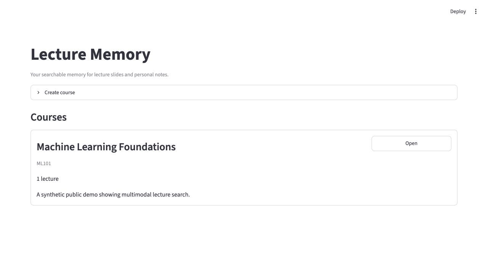
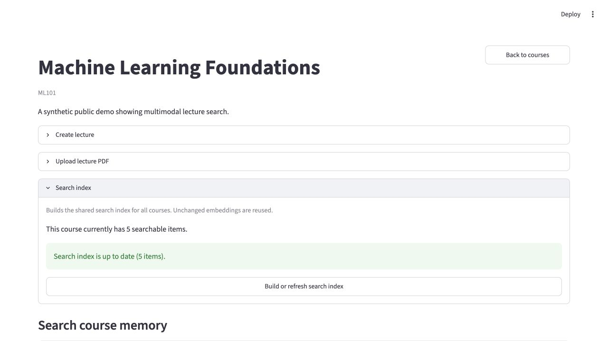
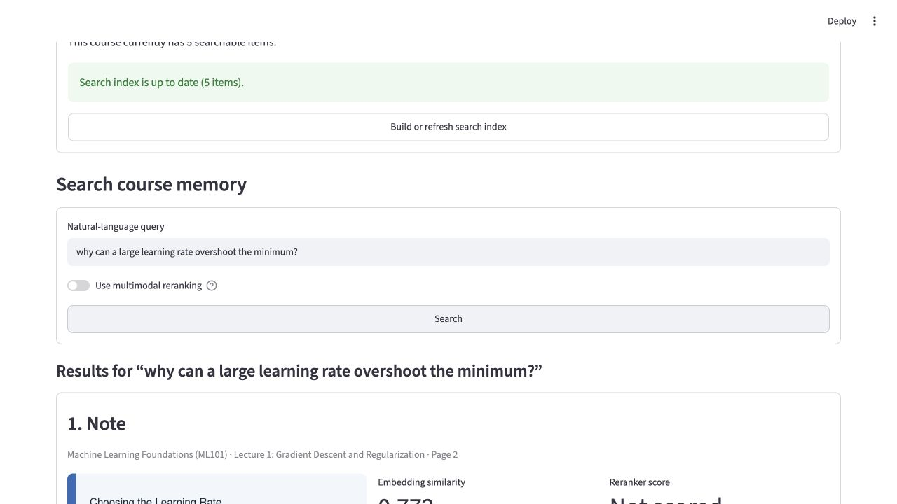

<h1 align="center">Lecture Memory</h1>

<p align="center"><strong>Remember the idea. Find the slide.</strong></p>

<p align="center">
  <a href="https://github.com/taotaokt/LectureMemory/actions/workflows/ci.yml"></a>
  
  
</p>

<p align="center">
  <a href="#demo">Demo</a> ·
  <a href="#how-it-works">How It Works</a> ·
  <a href="#getting-started">Getting Started</a> ·
  <a href="#evaluation">Evaluation</a> ·
  <a href="#welcome">Welcome</a> ·
  <a href="#license">License</a>
</p>

Lecture Memory helps students find ideas across lecture slides and personal notes—even when they cannot remember the exact wording, lecture, or page. Describe a concept, diagram, or explanation in your own words, and return to the original material with its course, lecture, and page context.

The project explores a practical question: **can search recover what a student remembers seeing, rather than only the words they remember reading?** It brings together visual and text retrieval in a local study workspace, with a bilingual benchmark to measure retrieval quality.

## What You Can Do

- **Keep courses organized.** Group lecture PDFs and personal notes by course and lecture.
- **Search the way you remember.** Ask about an idea, equation, or visual without knowing its exact title.
- **Find slides and notes together.** Review ranked matches with slide previews and source context.
- **Connect notes to the material.** Add lecture-wide notes or attach them to a specific slide.
- **Choose a search mode.** Use fast search for quicker lookup, or enable reranking for a second relevance check.
- **Work with local materials.** Store your imported PDFs, notes, and search index on your own machine.

> **Status:** Working research prototype. Course organization, PDF upload, slide browsing, note editing, index building, and natural-language search are implemented. Search quality and speed remain areas for improvement.

## Demo

The screenshots use a synthetic machine-learning course. No private lecture material is included.

**Organize your courses**



**Browse slides and keep related notes in one workspace**



**Find relevant slides and notes from a natural-language query**



## How It Works

1. **Bring in your materials.** Create a course and lecture, upload a PDF, and add notes while reviewing the slides.
2. **Make them searchable.** Build the search index. Lecture Memory represents slide images and note text in a shared searchable space, allowing visual content and written ideas to be matched to a query.
3. **Describe what you remember.** Search within a course using a question or short description. You can also enable multimodal reranking to reassess the initial matches.
4. **Return to the source.** Open the matching lecture and slide, inspect the preview, and read the associated notes.

Try queries such as:

```text
Where did the professor explain convex sets?
Find the slide showing convex and non-convex shapes.
Find my note about why Karatsuba is faster.
```

Results point back to slides and notes; the current version focuses on finding source material rather than generating answers.

## Getting Started

### Install and launch

Use **Python 3.11+**. The following setup includes the local models needed for search:

```bash
git clone https://github.com/taotaokt/LectureMemory.git
cd LectureMemory

python3.11 -m venv .venv
source .venv/bin/activate
python -m pip install -e '.[qwen]'
cp .env.example .env

streamlit run streamlit_app.py
```

Open the local URL printed in your terminal.

The default public models download automatically when first needed; no API key is required. Allow several minutes for the initial download and keep at least **8 GiB of free disk space** for the embedding setup. Enabling reranking downloads a second model and requires additional space and memory. Apple Silicon or a CUDA-capable GPU is recommended; CPU execution is supported but slower. After download, cached models can be reused locally.

### Try the sample course

To explore without uploading your own files, stop the app and run:

```bash
python -m scripts.prepare_demo
DATA_DIR=data/demo python -m scripts.build_index
DATA_DIR=data/demo streamlit run streamlit_app.py
```

The demo includes three generated slides and two notes about gradient descent, learning rates, and L2 regularization. It uses a separate local data directory.

### Use your own materials

1. Launch the app with `streamlit run streamlit_app.py`.
2. Create a course, add a lecture, and upload its PDF.
3. Browse the slides and add general or slide-specific notes.
4. In the course workspace, expand **Search index** and select **Build or refresh search index**.
5. Enter a natural-language query under **Search course memory** and review the matches. Refresh the index after changing your materials.

For model settings, troubleshooting, command-line indexing, and developer setup, see the [technical guide](docs/technical-guide.md).

## Evaluation

The project includes **50 English and Chinese queries across three real course PDFs**, covering conceptual paraphrases, visual descriptions, and note-based recall. Evaluation compares keyword search (BM25), multimodal embeddings, and reranking, measuring both relevance and latency.

In a local Apple Silicon reference run on September 30, 2026:

| Search method | Recall@5 | Mean query time |
|---|---:|---:|
| Keyword search (BM25) | 0.540 | 0.3 ms |
| Multimodal embeddings | 0.900 | 304.7 ms |
| Embeddings + reranker | 0.960 | 10.5 s |

Recall@5 measures the average fraction of labeled relevant pages found in the first five results. These results illustrate a quality–latency tradeoff: reranking improved this metric but took substantially longer, and did not improve every ranking metric.

This is a small, project-specific benchmark, not a claim of general performance. A later rank-fusion experiment used a different ranking setup; its full results and limitations are documented in the [technical guide](docs/technical-guide.md#retrieval-evaluation). The fusion weight was selected using this dataset and has not been validated on a separate held-out set.

See the [benchmark documentation](benchmark/README.md) for query labels and evaluation instructions. Source lecture PDFs are private and are not distributed; reproducing the real-course evaluation requires authorized copies. The synthetic demo is available to try independently.

## Welcome

Students, researchers, and developers are welcome to explore Lecture Memory and try it with their own study materials.

- **Share feedback:** [open an issue](https://github.com/taotaokt/LectureMemory/issues) with a usability suggestion or a search example that did not work as expected.
- **Discuss research ideas:** suggest retrieval comparisons, evaluation improvements, or ways to support visual learning materials.
- **Contribute improvements:** propose a change in an issue or pull request. See the [technical guide](docs/technical-guide.md) and [project specification](PROJECT_SPEC.md) for implementation context.

When sharing examples, use synthetic content or material you have permission to publish.

## License

This repository does not currently include a license file. No open-source license has been granted for reuse, modification, or redistribution. Third-party libraries and model weights remain subject to their respective licenses.
